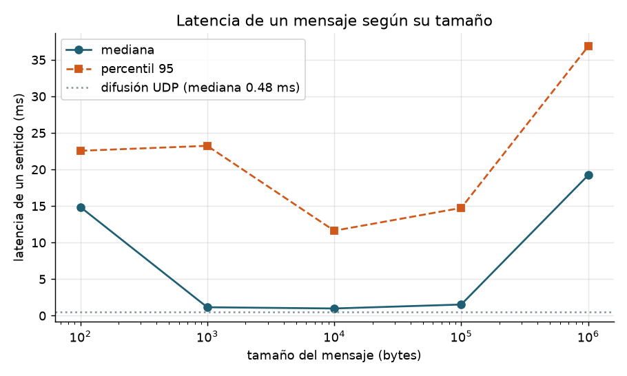
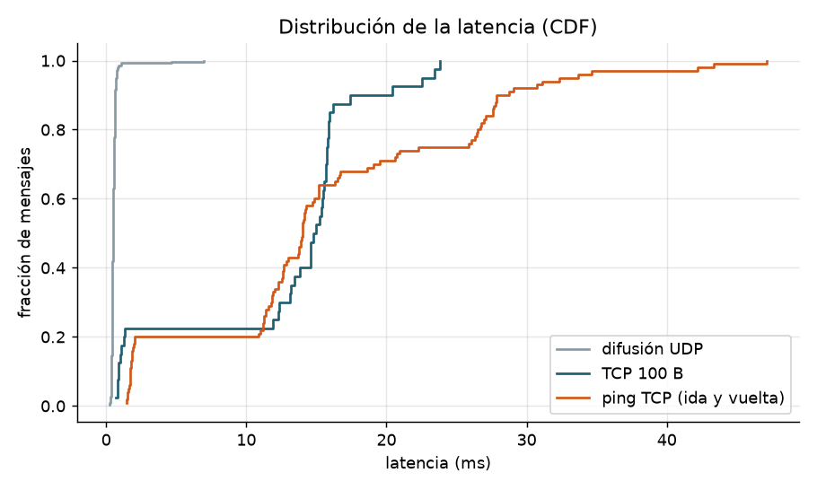
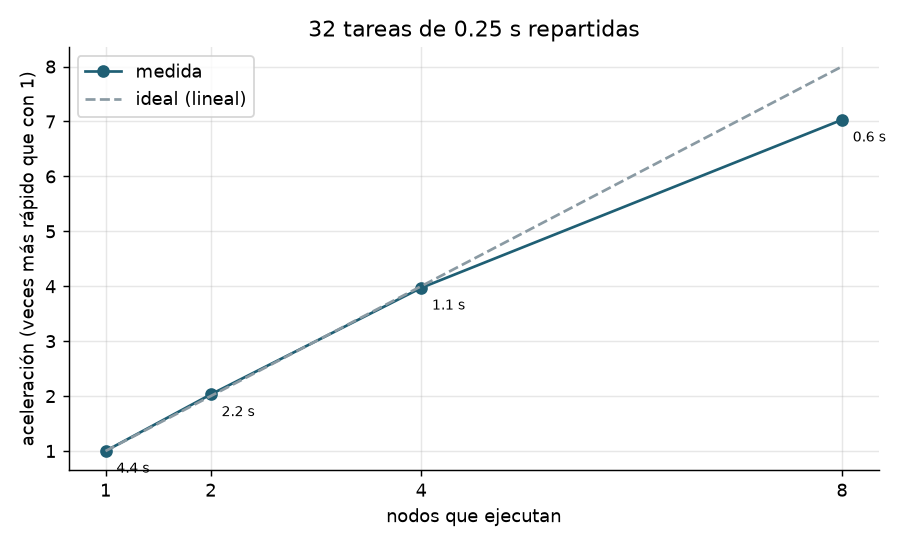
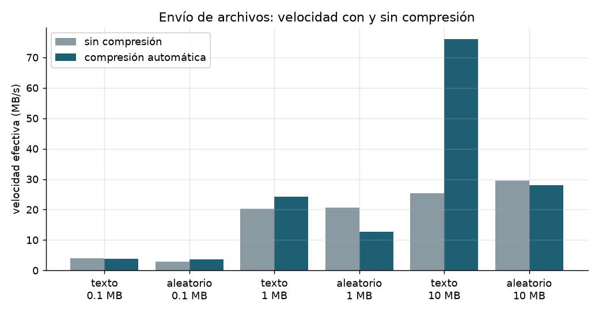
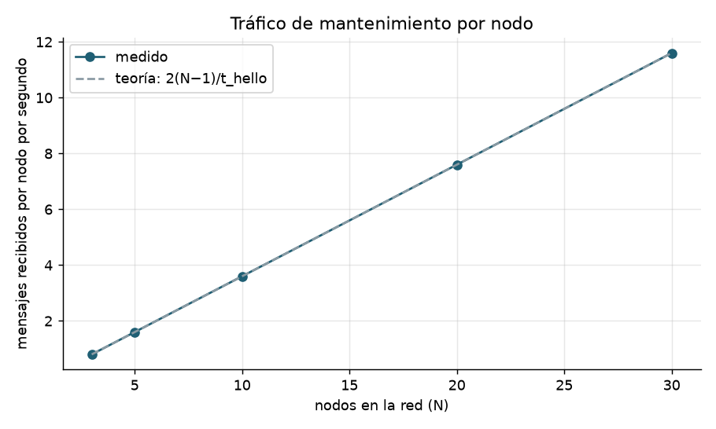
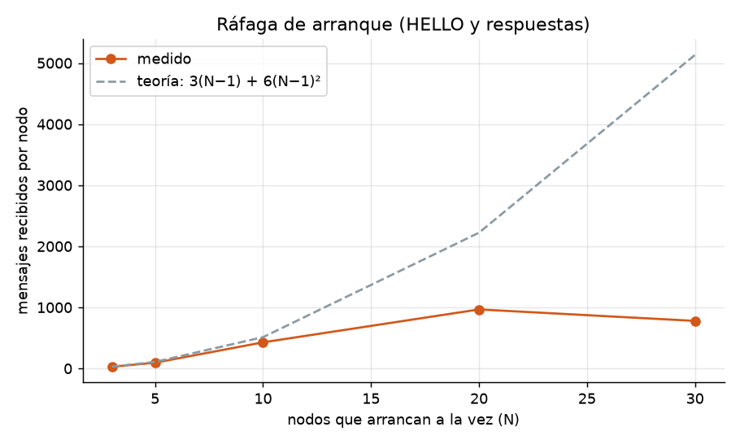
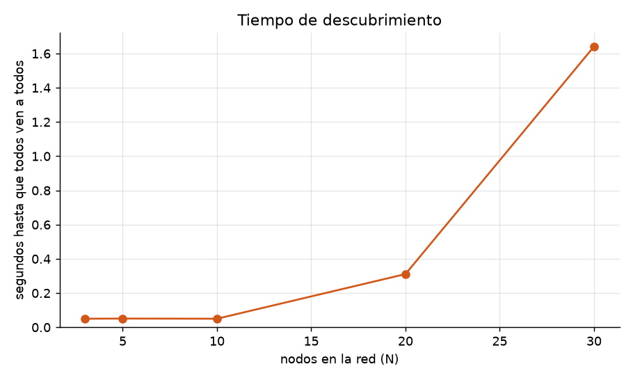
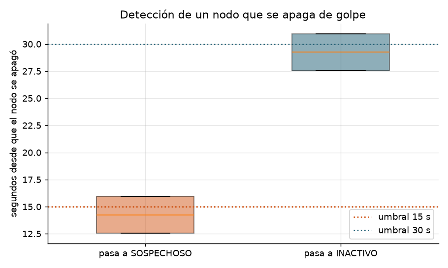
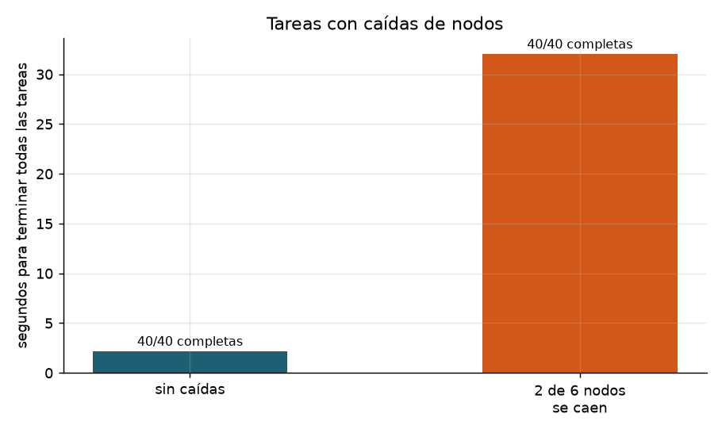

# Informe experimental

**ComplexNet API — latencia, escalabilidad y tolerancia a fallos**

Proyecto integrador de Sistemas Complejos — Universidad Sergio Arboleda.
Felipe Morales Robelto y Juan David Sánchez Vargas.

---

## Resumen

Se midieron cinco cosas: cuánto tarda un mensaje, cuánto tarda una tarea,
qué tan rápido viajan los archivos, cómo crece el tráfico al agregar nodos y
qué pasa cuando los nodos se caen. Los resultados principales:

| Qué | Resultado |
|---|---|
| Mensaje corto a todos (UDP) | **0,48 ms** (mediana), sin pérdidas en 300 envíos |
| Tarea pedida a otro nodo, ida y vuelta | **35 ms** (mediana) |
| 32 tareas repartidas entre 1 → 8 nodos | **4,39 s → 0,63 s**: 7 veces más rápido con 8 nodos |
| Archivo de texto de 10 MB | Viaja en **34 KB** gracias a la compresión; llega 3 veces más rápido |
| Tráfico de mantenimiento con 30 nodos | **11,6 mensajes/s por nodo** (3,5 KB/s), igual a la predicción teórica |
| Detección de un nodo que se apaga | **SOSPECHOSO a los 14,2 s** y **caído a los 29,2 s** (umbrales de 15 y 30 s) |
| Salida avisada (GOODBYE) | Los demás se enteran en **0,6 ms** |
| Se caen de golpe 2 de los 6 nodos que trabajan | **40 de 40 tareas** completas igual |

Además, las mediciones **encontraron tres defectos**, que se corrigieron y se
volvieron a medir (sección 8). El más importante: el planificador
concentraba casi todas las tareas en un solo nodo. Corregido, 8 nodos pasaron
de ser 2,6 veces más rápidos que uno a ser 7 veces más rápidos.

---

## 1. Qué se midió y por qué

El documento del corte 1 pide que el sistema sea **escalable** (RNF03),
**tolerante a fallos** (RNF02) y **de bajo consumo** (RNF05). Estas
mediciones comprueban esas tres cosas con números:

| Experimento | Pregunta que responde | Requisito |
|---|---|---|
| 1. Latencia de mensajes | ¿Cuánto tarda en llegar un mensaje, según su tamaño? | RF03, RF05 |
| 2. Tareas | ¿Cuánto cuesta pedir una tarea? ¿Repartir entre más nodos acelera? | RF07, RF08, RNF03 |
| 3. Archivos | ¿Qué tan rápido viaja un archivo? ¿La compresión ayuda? | RNF05 |
| 4. Escalabilidad | ¿Cuánto tráfico genera la red con 3, 5, 10, 20 y 30 nodos? | RNF03, RNF05 |
| 5. Tolerancia a fallos | ¿Cuánto tarda en notarse una caída? ¿Se pierden tareas? | RF09, RF11, RNF02 |

## 2. Cómo se midió

**Herramienta:** `experimentos/medir.py`, incluida en el repositorio. Cada
experimento se puede repetir con un solo comando y guarda sus datos crudos en
`experimentos/resultados/*.json`. Las gráficas salen de esos datos con
`experimentos/graficas.py`.

**Entorno:** todos los nodos corrieron en **un mismo computador**, un
portátil HP Victus 16 con 12 núcleos, Windows 11 y Python 3.11, sobre la red
interna del equipo (loopback). Fecha: 17 de noviembre de 2026.

**Por qué en un solo computador:** permite levantar **30 nodos**, algo
imposible con los equipos del laboratorio, y medir con un único reloj (la
latencia de un sentido solo se puede medir si emisor y receptor comparten
reloj).

**Qué significa esto para los números:**

- **Escalabilidad y tolerancia a fallos son válidas tal cual.** Dependen del
  protocolo (cuántos mensajes, cada cuánto, qué umbrales), no de la radio.
- **La latencia es un piso.** En la malla real hay que sumar el tiempo de la
  radio Wi-Fi y de cada salto de B.A.T.M.A.N. La sección 9 explica cómo
  medirla en la red real con la misma herramienta.

**Configuración:** la de fábrica (latido cada 5 s, sospecha a los 15 s,
inactivo a los 30 s, 2 tareas a la vez por nodo), salvo donde se indica.

---

## 3. Latencia de mensajes



| Mensaje | Mediana | Percentil 95 | Mínimo |
|---|---|---|---|
| Difusión UDP (a todos), 300 envíos | **0,48 ms** | 0,72 ms | 0,26 ms |
| TCP 100 B | 14,9 ms | 22,6 ms | 0,71 ms |
| TCP 1 KB | 1,2 ms | 23,2 ms | 0,61 ms |
| TCP 10 KB | 1,0 ms | 11,6 ms | 0,56 ms |
| TCP 100 KB | 1,5 ms | 14,7 ms | 1,07 ms |
| TCP 1 MB | 19,2 ms | 36,8 ms | 7,19 ms |
| Ping TCP (ida y vuelta) | 14,0 ms | 32,4 ms | 1,44 ms |

**Lectura:**

- **La difusión UDP es muy rápida y estable:** medio milisegundo, y ninguno de
  los 300 mensajes se perdió. Es lo que usan los latidos y los anuncios.
- **TCP varía mucho, y casi toda esa variación es de Windows, no del
  proyecto.** Se comprobó con un servidor mínimo, sin nada de ComplexNet:
  abrir una conexión TCP a veces tarda 0,7 ms y a veces 13,6 ms, según el
  estado del sistema. Por eso la mediana de 100 B salió *más alta* que la de
  10 KB. El **mínimo** muestra el costo real del protocolo: menos de 1 ms
  hasta 10 KB.
- **Hasta 100 KB el tamaño casi no importa.** Domina el costo de abrir la
  conexión. Con 1 MB ya pesa el tamaño: unos 7 ms en el mejor caso.
- **Consecuencia de diseño:** ComplexNet abre una conexión TCP nueva por cada
  mensaje. Es más simple y más robusto ante caídas (no hay conexiones
  "colgadas" que vigilar), pero hace que abrir la conexión sea el costo
  principal de los mensajes pequeños. Si en el futuro hiciera falta más
  velocidad, se podrían reusar las conexiones.



## 4. Tareas

**Una tarea de ida y vuelta** (pedirla con `TASK_ASSIGN` y recibir el
`TASK_RESULT`) tarda **35 ms de mediana** (p95: 49 ms). Son dos mensajes TCP
más escoger el nodo y ejecutar.

**Repartir trabajo:** se pidieron 32 tareas de 0,25 s cada una y se varió
cuántos nodos podían hacerlas.



| Nodos que ejecutan | Tiempo total | Aceleración | Tareas por nodo |
|---|---|---|---|
| 1 | 4,39 s | 1,0× | 32 |
| 2 | 2,17 s | 2,0× | 16, 16 |
| 4 | 1,11 s | 4,0× | 8, 8, 8, 8 |
| 8 | 0,63 s | **7,0×** | 4 a cada uno |

**Lectura:** la aceleración es casi la ideal. Con 8 nodos se pierde un poco
porque el tiempo de pedir y devolver cada tarea (unos 35 ms) empieza a pesar
frente a los 0,25 s de cada tarea. El reparto es exactamente parejo: el
planificador le da a cada nodo la misma cantidad de trabajo.

> Estos números son **después** de corregir un defecto del planificador
> (sección 8.1). Antes, 8 nodos eran solo 2,6 veces más rápidos que uno.

## 5. Archivos y compresión



| Archivo | Sin compresión | Con compresión automática | Lo que viajó |
|---|---|---|---|
| Texto, 1 MB | 0,049 s | 0,041 s | **4 KB** (de 1000 KB) |
| Texto, 10 MB | 0,394 s | **0,132 s** | **34 KB** (de 10 000 KB) |
| Aleatorio (como una foto), 10 MB | 0,339 s | 0,356 s | 10 MB (no se comprimió) |

**Lectura:**

- **Un texto (un censo, una lista, un registro de sensores) se comprime
  cientos de veces.** Incluso en la red interna, donde la red sobra, el de
  10 MB llegó 3 veces más rápido.
- **En la malla real la diferencia será mucho mayor.** Allá lo escaso es la
  red, no la CPU: mandar 34 KB en vez de 10 MB por una radio compartida es la
  diferencia entre segundos y minutos.
- **Lo que no se puede comprimir no se toca.** Con datos aleatorios el sistema
  detecta, con una muestra, que no vale la pena y manda el archivo tal cual.
  Solo pierde unos milisegundos en la prueba.

## 6. Escalabilidad

Se levantaron 3, 5, 10, 20 y 30 nodos a la vez y se midió el tráfico en dos
momentos: el **arranque** (cuando todos se presentan) y el **régimen
estable** (el día a día).

### 6.1 Régimen estable: crece en línea recta



Cada nodo manda 2 mensajes cada 5 s (`HEARTBEAT` y `RESOURCE_UPDATE`), así
que cada nodo debería recibir **2(N − 1) / 5** mensajes por segundo.

| Nodos | Recibidos por nodo (medido) | Teoría | Ancho de banda por nodo | Mensajes en toda la red |
|---|---|---|---|---|
| 3 | 0,8 /s | 0,8 /s | 0,35 KB/s | 2,4 /s |
| 5 | 1,6 /s | 1,6 /s | 0,58 KB/s | 8,0 /s |
| 10 | 3,6 /s | 3,6 /s | 1,15 KB/s | 36 /s |
| 20 | 7,6 /s | 7,6 /s | 2,32 KB/s | 152 /s |
| 30 | 11,6 /s | 11,6 /s | 3,48 KB/s | 348 /s |

**Lectura:** **la medición coincide exactamente con la teoría** en todos los
casos. El costo por nodo crece en línea recta con N, y es pequeño: con 30
nodos cada uno recibe 3,5 KB/s, casi nada para una red Wi-Fi.

### 6.2 Arranque: la ráfaga de HELLO



Al arrancar, cada nodo grita 3 `HELLO`, y **cada vecino le contesta a toda la
red** con `HELLO_ACK` y su `RESOURCE_UPDATE`. Si todos arrancan a la vez,
cada nodo recibe del orden de **6(N − 1)²** mensajes en un par de segundos.

| Nodos | Mensajes por nodo al arrancar | Teoría | Tiempo hasta que todos ven a todos |
|---|---|---|---|
| 3 | 28 | 30 | 0,05 s |
| 5 | 94 | 108 | 0,05 s |
| 10 | 428 | 513 | 0,05 s |
| 20 | 967 | 2 223 | 0,31 s |
| 30 | 779 | 5 133 | 1,64 s |

**Lectura:** hasta 10 nodos se cumple la teoría y todos se encuentran en
50 ms. **Desde 20 nodos la ráfaga satura los búferes de recepción:** se
pierden mensajes (por eso lo medido queda muy por debajo de la teoría) y
encontrarse pasa a tardar 1,6 s. El sistema igual converge, porque los
latidos de los segundos siguientes completan lo que se perdió.

**Es el punto débil de escalabilidad que se encontró.** Ya estaba anotado como
pendiente, y ahora está medido. La mejora es contestar el `HELLO` solo a quien
lo mandó (unicast) en vez de a toda la red: la ráfaga pasaría de crecer con
N² a crecer con N. En la práctica, los equipos de una brigada no arrancan
todos en el mismo instante, así que la ráfaga real es mucho menor que en esta
prueba.



## 7. Tolerancia a fallos

### 7.1 Detección de un nodo que se apaga de golpe

En una red de 5 nodos se apagó uno de golpe, sin despedirse, como si se le
acabara la batería. Se repitió 3 veces, en distintos momentos del ciclo de
latidos, y se midió en cada uno de los 4 que quedaban (12 mediciones).



| Evento | Mediana | Rango | Umbral configurado |
|---|---|---|---|
| Pasa a **SOSPECHOSO** | 14,2 s | 12,5 a 15,9 s | 15 s |
| Pasa a **INACTIVO** (se da por caído) | 29,2 s | 27,5 a 31,0 s | 30 s |
| Vuelve a prenderse y lo ven de nuevo | 16 ms | 5 a 17 ms | — |

**Lectura:** los umbrales se cumplen. La variación de ±2,5 s es la esperada:
el silencio se cuenta desde el **último latido** recibido, que pudo llegar
hasta 5 s antes del apagado, más el segundo que tarda la vigilancia en
revisar. Cuando el nodo vuelve, los demás lo reintegran en milisegundos, sin
que nadie configure nada.

### 7.2 Salida avisada (GOODBYE)

Cuando un nodo se apaga en orden, los demás lo sacan de la lista en
**0,6 ms**. (Antes de una corrección tardaba 460 ms; ver la sección 8.2.)

### 7.3 Reasignación de tareas

| Caso | Qué pasó | Tiempo hasta tener el resultado |
|---|---|---|
| El nodo que hacía la tarea **se cae** | Se esperó a darlo por caído y se reasignó | **31,5 s** (2 intentos) |
| El nodo **se demora** más del límite (3 s) | Se reasignó al vencer el límite | **3,5 s** |
| La tarea **no se pudo entregar** | Se pasó al siguiente nodo | 4,6 s en Windows; ~0,5 s en Linux* |

\* Windows tarda 2,05 s en rendirse cuando un puerto está cerrado (se midió
aparte), y ComplexNet lo intenta 2 veces. En Linux, que es lo que corre en la
malla, el rechazo es instantáneo y solo queda la espera de 0,5 s entre los
dos intentos.

**Lectura:** en los tres casos la tarea **termina en otro nodo**, sin que la
aplicación haga nada. El caso de caída tarda lo que tarda el umbral de 30 s,
que es una decisión de diseño (decisión 4): es preferible esperar un poco a
reasignar trabajo de un nodo que solo se demoró. Si una tarea es urgente, su
límite de tiempo hace que se reasigne antes.

### 7.4 Carga de trabajo con caídas

Se pidieron 40 tareas de 0,5 s a 6 nodos. Al segundo 1 se apagaron de golpe
**los 2 nodos con más trabajo**, que tenían 7 tareas en curso.



| | Tareas completas | Tiempo total | Reasignadas |
|---|---|---|---|
| Sin caídas | **40 / 40** | 2,16 s | 0 |
| Con 2 nodos caídos | **40 / 40** | 32,0 s | 3 |

**Lectura:** **no se perdió ninguna tarea.** Cuatro de las siete alcanzaron a
devolver su resultado justo antes de la caída; las otras tres se reasignaron
cuando los nodos se dieron por caídos (a los 30 s). El tiempo extra es
exactamente esa espera.

---

## 8. Defectos encontrados y corregidos

Medir sirvió para algo más que reportar números: encontró tres defectos que
las pruebas automáticas no veían.

### 8.1 El planificador concentraba el trabajo en un solo nodo

**Síntoma:** al repartir 32 tareas entre 8 nodos, el reparto fue
`[2, 2, 2, 2, 2, 2, 2, 18]`. Con 8 nodos el trabajo salía solo 2,6 veces más
rápido que con uno.

**Causa:** dos efectos juntos.

1. **La carga L tenía un tope en 1.** Cuando todos los nodos tenían sus 2
   tareas en curso, todos quedaban con L = 1 y la fórmula ya no distinguía
   entre un nodo con 2 tareas en fila y uno con 18.
2. **La confiabilidad se retroalimentaba.** El nodo que terminaba una tarea
   subía su R, eso subía su puntaje F, recibía más tareas, terminaba más...
   El típico efecto de "el rico se hace más rico" de los sistemas complejos.

**Corrección:** se quitó el tope de L. Ahora L = carga publicada + tareas
asignadas sin respuesta / capacidad, aunque pase de 1. Un nodo con 18 tareas
en fila tiene L = 9 y deja de recibir más. La confiabilidad sigue premiando a
los buenos nodos, pero ya no puede acaparar el trabajo.

**Resultado:** reparto exactamente parejo (`[4, 4, 4, 4, 4, 4, 4, 4]`), 8
nodos 7 veces más rápidos que uno, y la carga de 40 tareas en 6 nodos pasó de
4,21 s a 2,16 s.

### 8.2 La despedida (GOODBYE) salía tarde

**Síntoma:** los demás veían la salida avisada de un nodo 460 ms después.

**Causa:** al apagarse, el nodo primero cerraba su gestor de tareas, lo que
tarda hasta medio segundo, y solo después se despedía.

**Corrección:** ahora se despide primero. Además, así los demás reasignan
antes las tareas que tenía ese nodo.

**Resultado:** 0,6 ms.

### 8.3 La difusión quedaba en 0.0.0.0 (encontrado en la red real)

Se encontró probando en los equipos reales, antes de estas mediciones: si a
`bat0` se le pone la IP sin `brd +`, Linux deja su dirección de difusión en
`0.0.0.0` y los anuncios no le llegan a nadie. Se corrigió en
`setup_adhoc.sh`, y el código ahora calcula la difusión a partir de la IP y la
máscara si Linux no la da (decisión 27).

---

## 9. Cómo repetir las mediciones

En un solo computador:

```bash
cd complexnet-api
pip install -r requirements.txt matplotlib
python experimentos/medir.py todo          # todo, unos 10 minutos
python experimentos/medir.py fallos        # o solo una parte
python experimentos/graficas.py            # las gráficas
```

**En la malla real** (con la mensajería abierta en los demás equipos):

```bash
sudo python3 experimentos/medir.py malla
```

Mide el ping a cada nodo, la tarea `calcular` de ida y vuelta y el envío de
archivos con y sin compresión, y guarda también la tabla de rutas de
B.A.T.M.A.N. (`batctl o`), para saber por cuántos saltos pasó cada medida.
Los resultados quedan en `experimentos/resultados/malla.json`.

Para la tolerancia a fallos en la malla real: apagar un equipo de golpe y
correr `python examples/analizar_logs.py logs` con los registros de los demás.
Esa herramienta ya calcula cuánto tardó cada nodo en pasar de SOSPECHOSO a
INACTIVO.

### Resultados en la malla real

*Pendiente:* completar al medir con los equipos del laboratorio.

| Medida | Resultado |
|---|---|
| Ping a un vecino directo (1 salto) | |
| Ping a un nodo a 2 saltos | |
| Tarea `calcular` ida y vuelta | |
| Archivo de texto de 1 MB (con compresión) | |
| Archivo aleatorio de 1 MB | |
| Detección de caída (SOSPECHOSO / INACTIVO) | |

## 10. Conclusiones

1. **El sistema escala bien en régimen estable.** El tráfico de mantenimiento
   crece en línea recta con el número de nodos y coincide exactamente con lo
   que predice el diseño: con 30 nodos cuesta 3,5 KB/s por nodo.
2. **El procesamiento distribuido funciona.** Repartir tareas entre 8 nodos
   acelera el trabajo 7 veces, con un reparto parejo.
3. **La red tolera caídas sin perder trabajo.** Los umbrales de 15 y 30 s se
   cumplen, ninguna tarea se perdió aunque se cayeran los nodos más ocupados,
   y un nodo que vuelve se reintegra en milisegundos.
4. **La compresión es la mejora más rentable para una malla.** Los datos de
   texto, como los de los sensores, se reducen cientos de veces.
5. **Hay un punto débil identificado:** la ráfaga de arranque cuando muchos
   nodos arrancan a la vez. Se propone contestar el `HELLO` por unicast.
6. **Medir encontró defectos que las pruebas no veían**, entre ellos uno
   importante en el planificador. Las mediciones no solo confirman el
   diseño: también lo mejoraron.
